 

Desenvolvedor Java júnior na **Memora**, onde trabalho em sistemas para o governo
do estado. Entrei como estagiário e fui efetivado depois de um ano. Sou formado em
Biologia e em Análise e Desenvolvimento de Sistemas pela UNIALFA, e moro em Goiânia.

 

 

  

 

  <a href="https://branhub.vercel.app">branhub.vercel.app</a> ·
  <a href="https://x.com/BrandRFL">X @BrandRFL</a>

