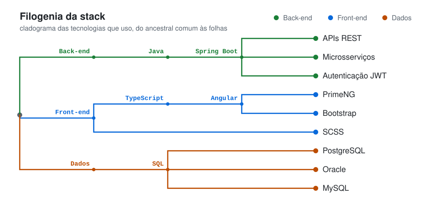

<picture>
  <source media="(prefers-color-scheme: dark)" srcset="assets/banner-dark.svg">
  
</picture>

Sou biólogo e desenvolvedor. Hoje trabalho como dev júnior na **Memora**, em
sistemas Java para o governo do estado, depois de um ano de estágio na mesma
empresa. Sou formado em Análise e Desenvolvimento de Sistemas pela UNIALFA e
moro em Goiânia.

A biologia me deixou o hábito de olhar para sistemas como organismos: partes
que se comunicam, dependem umas das outras e precisam continuar funcionando
quando o ambiente muda.

<picture>
  <source media="(prefers-color-scheme: dark)" srcset="assets/filogenia-dark.svg">
  
</picture>

## Projetos

**[LAEC](https://github.com/RafaBran/laec)**: sistema de gerenciamento e
agendamento do Laboratório de Análise Experimental do Comportamento da
UNIALFA. Back-end em microsserviços (autenticação, usuários, laboratório e
gateway) com Spring Boot e PostgreSQL, front-end em Angular.

**[Calculadora de Notas UNIALFA](https://github.com/RafaBran/calculadora-UNIALFA)**:
simulador das notas N1 a N4 conforme a Resolução 063/2023. Mostra a situação
do aluno e quanto falta em cada etapa. Angular e TypeScript, com as regras de
avaliação em funções puras cobertas por testes.

<picture>
  <source media="(prefers-color-scheme: dark)" srcset="https://raw.githubusercontent.com/RafaBran/rafaBran/output/petri-dark.svg">
  
</picture>

## Contato

[branhub.vercel.app](https://branhub.vercel.app) · [X @BrandRFL](https://x.com/BrandRFL)
